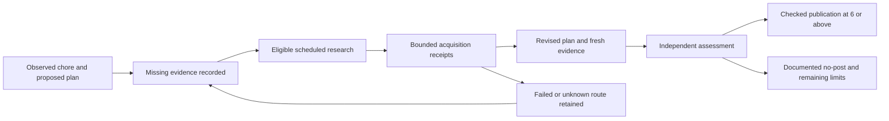

# Candidate development across scheduled cycles

Discovery and publication stay separate. The existing clock and budgets remain
unchanged; one eligible candidate can receive focused research inside an ordinary
run. New records never grant a score or permission to publish.

## Records and identity

`research-intents` preserves the original proposed plan and exact provenance.
`research-results` records actual start/terminal events before model access.
`candidate-development` is an append-only, deterministic record written after
trusted finalization. It links candidate origins, evidence acquisition, revisions,
independent assessment and verified publication. Original run files are not edited.

A case is identified by canonical source URL. A revision binds candidate content,
primary evidence and relevant capability-evidence fingerprints. A plan-only rewrite
is explicitly different from new capability evidence or changed source evidence.
Historical writer scores remain provisional, even when a batch no-post assessment
was independently examined.

The active projection reads at most 96 development records and restores at most
64 unfinished cases, prioritizing cases with actionable evidence gaps. Older
records remain in Git. This bounds runtime work; it is not an infinite-memory or
guaranteed-publication claim.

## Routes and failures

Version2 intents identify individual acquisition routes. Their stable key includes
case identity, primary-evidence fingerprint and exact reference identity/URL;
unrelated catalog edits cannot reopen a failed route. Version1 intents remain
readable. A failed/unknown route stays parked, while an unattempted route or another
candidate remains eligible. Creating a plan is not an acquisition attempt.

When one capability was acquired and another remains unattempted, the next eligible
run can acquire the latter and freshly verify the former within the same two-reference
budget. A refresh is identified separately from a new acquisition. Failed routes
are not silently retried. If acquisition completed but no independently completed
revision exists, one bounded `review_evidence` continuation can refresh those
capabilities for evaluation; it adds no model invocation outside the normal cycle.

The projection exposes waiting, unknown acquisition, route failure, changed source,
new evidence, independently examined no-post and publication states. Publication
requires the real post's matching canonical URL, run, content hash and timestamp;
a lifecycle event alone cannot create it. Replaying records is idempotent, and an
older run cannot acquire a parent from its future.

Unresolved limitations are copied exactly from the proposed plan, not converted
into facts. Missing catalog support means no permitted automatic acquisition path;
it does not establish that a solution or demand is absent. Source changes require
a new source-bound revision. The original cooldown, privacy, literal evidence,
source-access and independent publication gates still apply.
